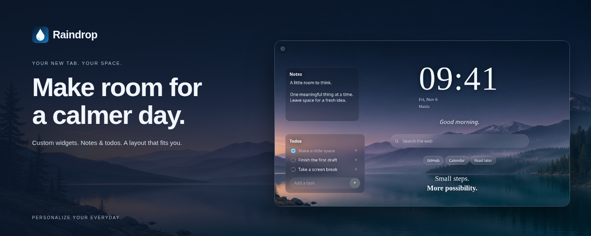

  

<h1 align="center">Raindrop</h1>

<strong>A minimal new tab. A space that feels like yours.</strong>

  <a href="#features">Features</a> ·
  <a href="https://chromewebstore.google.com/detail/raindrop/gneodennolcndlfopbghgdeedfblchna">Add to Chrome</a> ·
  <a href="#privacy-and-backups">Privacy &amp; backups</a>

Raindrop turns every new tab into a personal workspace for your day. Keep your tasks, notes, favorite links and world clocks together, with a layout you can shape around the way you work.

Choose a quiet background, arrange your widgets, and keep the essentials within reach. Whether you are planning your morning, working across time zones or saving an idea for later, your next tab is ready.

## Features

| Feature | Make it yours |
| --- | --- |
| **Personalized backgrounds** | Choose Unsplash photography, your own images, solid colors or animated raindrops. Adjust the look to suit your space. |
| **World clocks** | Follow multiple time zones with digital or analogue clocks and custom labels. |
| **Tasks and notes** | Keep a checklist for your priorities and a notepad for ideas, reminders and everyday thoughts. |
| **Flexible search** | Search with Google, DuckDuckGo, Bing, Brave, Ecosia, Startpage, Yahoo or YouTube—or configure a custom search URL. |
| **Quotes and greetings** | Add a personal greeting and a little inspiration to your dashboard. |
| **Quick links** | Put the websites you return to most right on your new tab. |
| **Custom widgets** | Add images, text and supported embedded content to build a dashboard beyond the basics. |
| **Free-arrangement groups** | Position, overlap and resize items inside a group, then move or scale the composition together. |
| **Layouts across screens** | Fit the whole dashboard to another screen, or choose relative or pixel positioning. |
| **Light and dark interface** | Choose Light, Dark or System for settings and dialogs, independently of your dashboard styling. |
| **Password protection** | Protect API keys, Notes and Todos with a shared master password and recovery phrase. Unlock private widgets when you need them. |
| **Backup options** | Export a local backup or use Google Drive or GitHub Gist to sync supported settings between installations. |

## A dashboard built around you

Start with the widgets you use and hide the rest. Change their size, position and appearance, or combine them into a composition that stays together when your screen changes.

Keep it simple with a clock and search bar. Make room for notes and a daily checklist. Add photos and personal touches when you want your workspace to feel more like home.

## Add Raindrop to Chrome

[**Add to Chrome — Chrome Web Store**](https://chromewebstore.google.com/detail/raindrop/gneodennolcndlfopbghgdeedfblchna)

Install Raindrop from the Chrome Web Store, then open a new tab to make it yours.

Choose your background, show the widgets you need, and arrange your dashboard. Account Settings brings password protection, recovery and API keys together in one place. Online features may require provider keys or account authorization.

## Privacy and backups

Your dashboard settings are stored locally in the browser extension. Cloud backup is optional: Google Drive uses the app's hidden application-data folder, while GitHub backup uses a Gist you configure.

A shared master password can protect API keys, Notes and Todos. Restoring protected settings can activate API services while keeping Notes and Todos locked until you manually unlock them. API-key reveal controls ask for the password again before showing a saved key.

**The entire dashboard backup is not automatically encrypted.** Private-content inclusion depends on your settings; enable Notes/Todos encryption before syncing content you want encrypted. Keep your recovery phrase somewhere safe.

You can review the Terms of Use and Privacy Policy inside Raindrop under **Settings → About Raindrop**.

## Feedback and credits

Have an idea or found a bug? Use the support options on the [Chrome Web Store listing](https://chromewebstore.google.com/detail/raindrop/gneodennolcndlfopbghgdeedfblchna). When reporting an issue, include your browser version and the steps to reproduce it. Remove passwords, API keys and private content from reports or screenshots.

Built and maintained by **[RiANDRAFT](https://github.com/RiANDRAFT)**. Team credits are available inside **Settings → About Raindrop → Developer team**.

A little space. A better start.
